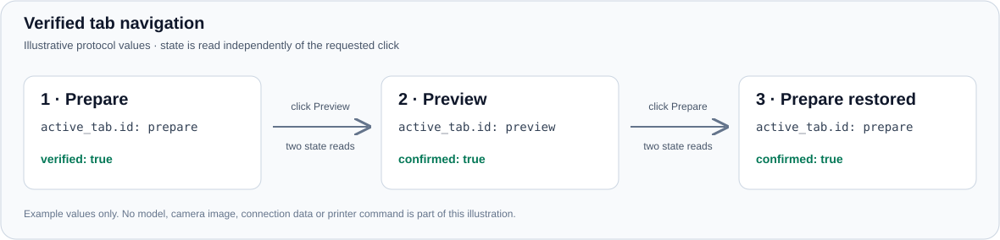

# Bambu Studio MCP Workflow

[](#compatibility)
[](https://github.com/Nekowarrior777/bambu-studio-mcp-workflow/releases/tag/v0.1.1)
[](LICENSE)

Prepare Bambu Studio projects, operate observed Studio controls, and check a Bambu Lab P1S through ordinary requests to Codex. This Windows MCP extension adds verified UI navigation and a reusable `bambu-print` skill to the existing project and printer tools.

The workflow combines two MCP servers:

| Your task | Component |
|---|---|
| Inspect a saved 3MF, prepare a copy, arrange or slice a model | `unofficial-bambu` project tools |
| Operate Studio buttons and confirm Prepare/Preview navigation | The local UI extension inside `unofficial-bambu` |
| Read printer state, temperatures and camera | The separate `bambu-printer` connector |
| Follow the right sequence for review, preparation or an explicitly requested print | The `bambu-print` Codex skill |

[Quick start](#quick-start) · [Example requests](#example-requests) · [Compatibility](#compatibility) · [Troubleshooting](docs/TROUBLESHOOTING.md) · [Validation](VALIDATION.md)

## Example requests

After setup, you can ask:

> Inspect my saved 3MF project. Check its orientation, supports and material settings, and explain the changes you recommend.

> Prepare a separate copy for a stronger part. Keep the original project and stop before sending anything to the printer.

> Switch Studio from Prepare to Preview, confirm the active tab, and restore the original tab. Keep the project settings unchanged.

> Show my P1S status, current and target temperatures, and a fresh camera image.

The skill reads the actual project and printer context. Material and temperature choices belong to the current job; they are not universal defaults.

## Verified navigation



*Protocol illustration using example values. The active state comes from native Studio window visibility; the diagram contains no model or printer identifiers.*

`studio_ui_inspect` reports the observed active view. A recognized Prepare/Preview click returns `verification.confirmed` only after two consecutive reads of the requested state. An uncertain result stays unconfirmed and is never automatically replayed. See the [active-tab contract](tools/unofficial-bambu-mcp/local_extension/ACTIVE_TABS.md).

## Quick start

Use **Windows 10/11 x64**, installed Bambu Studio, **Python 3.14**, **Node.js 24**, Git/npm, and the Windows .NET Framework 4.x compiler. Install the Codex CLI if you want automatic registration.

For a **fresh Codex setup**, run these commands from PowerShell:

```powershell
git clone https://github.com/Nekowarrior777/bambu-studio-mcp-workflow.git
cd bambu-studio-mcp-workflow
powershell -NoProfile -File .\scripts\install.ps1 -PythonExe python -RegisterCodex -InstallSkill
```

The opt-in switches register `unofficial-bambu` and install the skill. For a manual setup or an existing installation, omit those switches and follow the [getting-started guide](docs/GETTING_STARTED.md). Conflicting registrations or skills stop the relevant step and are preserved.

The installer prepares the pinned `bambu-printer-mcp` runtime but **does not register or configure the separate `bambu-printer` connector**. Complete that step using the guide before checking printer status or using final Send.

Review [SECURITY.md](SECURITY.md) before connecting a printer. Keep completed connection settings outside the repository. The installer itself performs no printer or Studio UI action.

Restart Codex after registering servers or installing the skill. Open a saved project in Studio, then start with:

> Use $bambu-print to inspect Bambu Studio and printer status only. Do not print or change settings.

For copyable templates, see [Codex TOML](examples/codex.mcp.example.toml) and [generic MCP JSON](examples/mcp-servers.example.json). Replace placeholders in your private client configuration; example files contain no working connection values.

## Compatibility

| Area | Current scope |
|---|---|
| UI platform | Windows 10/11 x64 |
| Verified Prepare/Preview state | Bambu Studio **02.08.02.61**, using a strict native-window profile |
| Project inspection | Saved `.3mf` files; unsaved GUI edits need a separate saved copy |
| Guarded final Send route | **P1S, 0.4 mm nozzle, Textured PEI, one external-spool material** |

Unsupported Studio versions or ambiguous native layouts return an unknown active view. Hidden/minimized windows and changed/disabled controls reject input. Other controls depend on their available native UI patterns.

**This is a source-only prerelease. Clean-machine installation and a fresh physical print through the extension's final Send remain unverified.** The public source passed 53 Python tests and 40 isolated Windows checks. Live development checks confirmed Prepare -> Preview -> Prepare with the original view, visible settings and saved project preserved. Read [VALIDATION.md](VALIDATION.md) for the complete evidence boundary and [SECURITY.md](SECURITY.md) for the inherited LAN certificate-validation limitation.

## Tool reference

The extension preserves upstream tools and adds these seven commands:

| Tool | Purpose |
|---|---|
| `studio_ui_status` | List actual Studio windows and available operations |
| `studio_ui_inspect` | Read observed controls and supported active-view evidence |
| `studio_ui_action` | Act once on an observed control; verify recognized tab transitions |
| `studio_dispatch_diagnostics` | Read-only exact-file and fresh-printer checks |
| `studio_open_print_dialog` | Open the official dialog for a recorded exported artifact |
| `studio_prepare_send` | Check readiness and create an expiring, single-use ticket |
| `studio_submit_send` | Attempt final Send once and observe the corresponding printer job |

UI actions use Windows UI Automation or events bound to the control's checked HWND. Observations expire after 30 seconds and are consumed before executed input. Physical controls use dedicated printer tools, and final Send keeps its file, identity, readiness and duplicate-send checks.

For an explicitly requested print, the path is `send_to_printer(via='bambu_studio')` -> open and inspect the dialog -> prepare a ticket -> submit once -> verify printer telemetry. The initial handoff opens Studio. Bed-clearance evidence and current printer checks are required before final submission.

## Documentation and support

- [Getting started](docs/GETTING_STARTED.md): installation, both MCP servers, private configuration and first connection checks.
- [Troubleshooting, updates and removal](docs/TROUBLESHOOTING.md): missing tools, unsupported versions, minimized Studio, expired observations and existing installations.
- [Active-tab verification](tools/unofficial-bambu-mcp/local_extension/ACTIVE_TABS.md): result fields, native profile and confirmation rules.
- [Validation](VALIDATION.md), [security](SECURITY.md), [changelog](CHANGELOG.md) and [third-party notices](THIRD_PARTY_NOTICES.md).

Report problems in [GitHub Issues](https://github.com/Nekowarrior777/bambu-studio-mcp-workflow/issues). Include the Windows/Studio version, tool name, expected result and a redacted error. Remove access codes, IP addresses, serial numbers, account details, personal paths and model contents before sharing logs or screenshots.

## Components and development checks

| Component | Version |
|---|---|
| Source distribution | 0.1.1 |
| Native Windows UI adapter | 0.1.1 |
| Python extension wrapper | 0.1.0 |
| Upstream `unofficial-bambu-mcp` | 0.3.0 |

This is an unofficial community integration. Bambu Studio is installed separately. The source does not replace an upstream release or change printer/network modes.

After installation, run isolated software checks from the repository root:

```powershell
& .\tools\unofficial-bambu-mcp\.venv\Scripts\python.exe -m unittest discover -s .\tools\unofficial-bambu-mcp\tests -v
powershell -NoProfile -File .\tools\unofficial-bambu-mcp\local_extension\build_studio_ui.ps1 -WithFixture
& .\tools\unofficial-bambu-mcp\local_extension\StudioUiFixture.exe --self-test
```

The fixture uses its own synthetic window. Physical printing is a separate, explicitly authorized workflow.

Licensed under [GPL-2.0](LICENSE); see [third-party notices](THIRD_PARTY_NOTICES.md) for upstream components.
